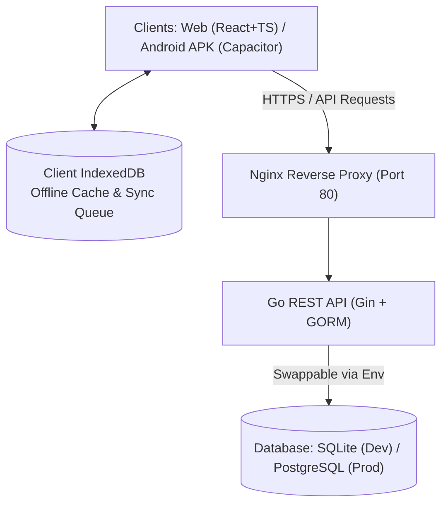

# Bayti Kitchen Architecture Documentation

## 1. System Overview
**Bayti Kitchen** is a production-grade, offline-first household food and kitchen management platform designed for families. It combines real-time inventory tracking, meal planning, smart grocery shopping, and authentic recipe management with atomic stock deduction guarantees.

---

## 2. Core Pillars & Architecture

### A. Navigation & Mobile UX
- **Maximum Navigation Depth = 2**: Eliminates nested routing confusion.
- **Fixed Bottom Navigation**: 4 main tabs (`Home`, `Kitchen`, `Shopping`, `Recipes`).
- **Unified Bottom Sheet Modal System**:
  - All add, edit, and view actions open smooth bottom sheets.
  - Rounded top corners (`rounded-t-3xl`).
  - Gesture drag-handle for swipe-to-close.
  - Internal smooth scroll.
  - Prevents nested dialog stacking.

### B. Offline-First & Sync Engine
1. **IndexedDB Local Storage**:
   - Stores full copies of ingredients, recipes, meal plans, units, and shopping lists.
   - Operates flawlessly without an active internet connection.
2. **Offline Mutation Queue**:
   - Any create, update, or delete action taken while offline is stamped with a unique UUID (`client_op_id`), timestamp, and JSON payload, then stored in `sync_queue`.
3. **Idempotent Background Synchronization**:
   - When the device comes online, `api.syncOfflineQueue()` sends the queued operations to `/api/sync`.
   - The backend checks `sync_operations.client_op_id` to prevent duplicate processing.
   - Operations are applied inside atomic transactions and cleared from the client's queue.

### C. Critical Meal Preparation & Inventory Transaction
The core rule of Bayti Kitchen:
- **No stock is deducted when viewing or scheduling meals.**
- Stock is **only** deducted when the user clicks **"تم تحضير الوجبة" (Meal Prepared)**.
- **Execution Flow:**
  1. Fetch recipe ingredients and scale quantities by the meal's servings factor.
  2. Verify inventory stock for all ingredients.
  3. If **any** ingredient has insufficient stock, the entire transaction **aborts completely** (zero partial deductions). The missing items are returned to the user with exact deficit amounts.
  4. If all ingredients are available, perform the deductions inside **one strict database transaction**.
  5. Insert an `inventory_transactions` record for each item with type `consumption`.
  6. Insert a `meal_preparations` record with a unique `idempotency_key` (UUID).
  7. If the same preparation request is resent with the same key, it returns the existing record without deducting stock again.

---

## 3. Unit Conversion & Dimensions
Units belong to strictly guarded dimensions:
- **Mass**: `kg` <-> `g` (1 kg = 1000 g)
- **Volume**: `l` <-> `ml` (1 liter = 1000 ml)
- **Count**: `piece`, `pack`, `can`

Cross-dimension conversion (e.g. Mass to Volume) is **strictly rejected** unless the ingredient defines a non-zero `density` (g/ml).

---

## 4. Smart Shopping Calculation
The shopping engine calculates needed items automatically:
$$\text{Deficit} = \sum(\text{Ingredients Needed for Scheduled Meals in Date Range}) - \text{Current Stock in Inventory}$$

When items are marked as purchased:
- The actual price paid and bought quantity are recorded.
- Stock is automatically credited to the kitchen inventory.
- An expense purchase entry is created.
